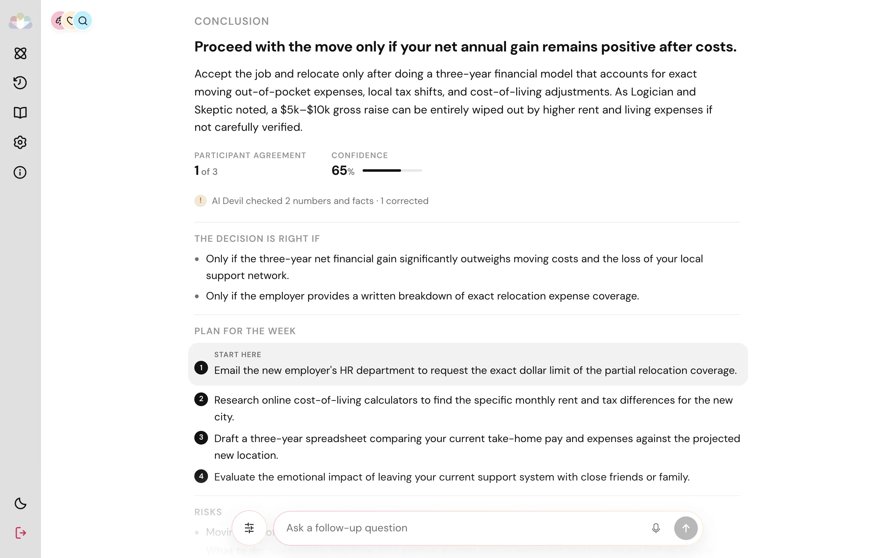
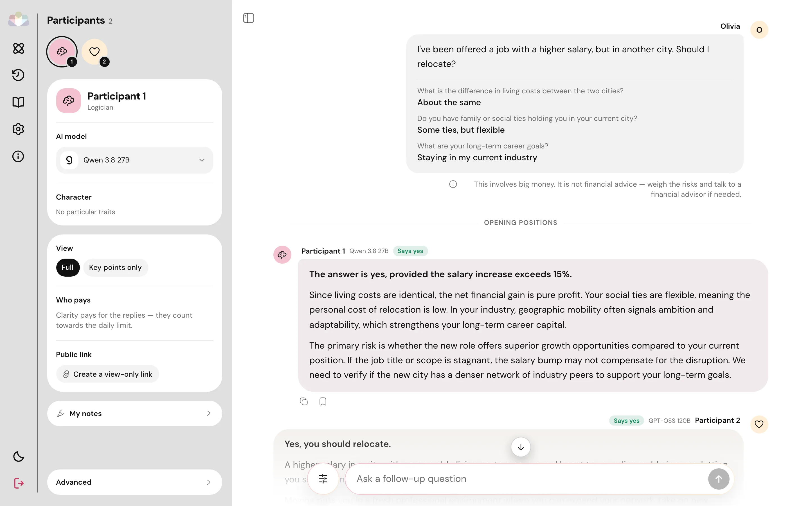
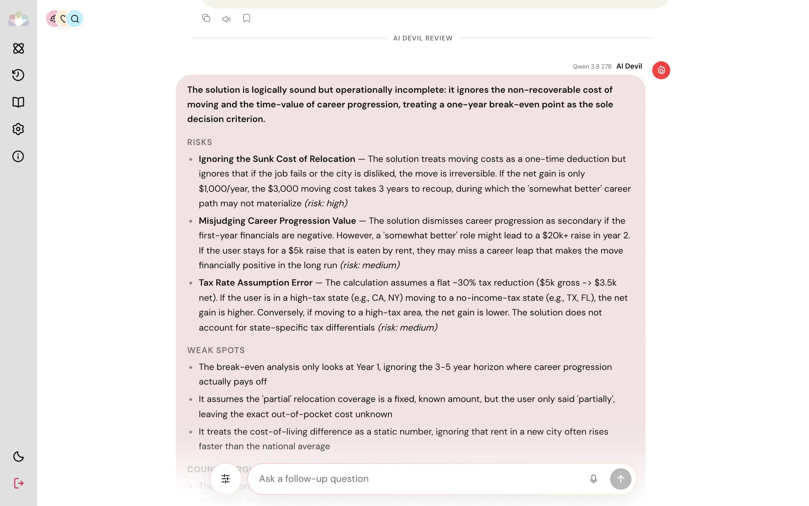

<div align="center">


# Clarity

**An AI council for hard decisions.**

Several AI participants with different personalities debate your question, a moderator turns the arguments into a decision, and an AI Devil hunts for its weak spots. You get a verdict with pros, risks, the minority view and a next step.

**[🌐 Try it live](https://clarity-three-xi.vercel.app/)** · [Case study](https://ttjelky.github.io/portfolio/en/work/clarity/)




</div>

## How it works

```
question → moderator's clarifying questions → openings → debate (2–3 rounds or until consensus)
         → moderator's decision → AI Devil check → participants respond → verdict
```

| Debate | AI Devil |
|:-:|:-:|
|  |  |

## Features

- **Debate engine** — a Django state machine runs the discussion one step at a time; steps run in a web-server thread or a separate worker
- **Any model** — OpenAI, Anthropic, Gemini, Groq, Cerebras, DeepSeek, Mistral, OpenRouter, Ollama or a custom endpoint; each participant can think on its own model
- **Real-world context** — web search (Tavily, Brave, SearXNG, Wikipedia) and attachments: PDF, Word, text, photos
- **Try without signing up** — a question on the landing page starts a real discussion as a guest; signing up later moves it into the account
- **Voice** — participants read their replies aloud, each in its own voice and tone, and questions can be dictated (Web Speech API, in the browser)
- **Examples gallery** — full real discussions on everyday choices, open without an account
- **After the decision** — a decision journal that later emails “How did it go?” and shows how often Clarity’s advice actually worked out, shareable public links, Ukrainian and English UI (the AI answers in the same language)
- **Accounts** — email or Google sign-in, password reset, rate limits, email verification in production
- **Tested** — 550+ backend tests, 150+ frontend tests and CI

---

## Документація для розробника (UA)

Clarity допомагає ухвалювати рішення: кілька AI-учасників із різними
характерами обговорюють ваше питання, модератор зводить аргументи в рішення,
AI Devil шукає в ньому слабкі місця, і наприкінці ви отримуєте висновок —
з плюсами, ризиками, думкою меншості й наступним кроком.

```
питання → уточнення модератора → вступ → дебати (2–3 раунди або до згоди)
        → рішення модератора → перевірка AI Devil → відповідь учасників → висновок
```

Інтерфейс — українською та англійською (за мовою пристрою або вибором у
налаштуваннях); тією ж мовою пишуть і AI.

## Що всередині

| Частина | Стек | Де |
| --- | --- | --- |
| API, рушій дебатів | Django 6, Django REST Framework | `backend/` |
| Інтерфейс | React 19, Vite, React Router | `frontend/` |
| Моделі | OpenAI-сумісні API (OpenAI, Gemini, Groq, Cerebras, DeepSeek, Mistral, OpenRouter, Ollama, власний endpoint) і Anthropic | `backend/discussions/services/providers.py` |
| Пошук | Tavily, Brave, SearXNG або Wikipedia | `backend/discussions/services/search.py` |

Головне в бекенді:

- `discussions/services/engine/` — рушій: стан-машина, яка робить один крок
  дискусії за виклик (`core.py`), готує виклики (`planning.py`), викликає
  моделі (`calls.py`) і розбирає відповіді (`parsing.py`). Опис фаз — у
  docstring пакета.
- `discussions/services/prompts/` — промпти учасників, суддів і уточнення.
- `discussions/services/runner.py` — хто виконує кроки: потік у вебсервері
  або окремий воркер (див. нижче).
- `discussions/journal.py` — журнал рішень: людина фіксує, що вирішила, а
  згодом Clarity питає «Як воно?» (`services/reminders.py` — листи).
- `discussions/services/attachments.py` — вкладення: текст із PDF, Word,
  текстових файлів і фото (фото читає модель, що бачить зображення).
- `accounts/` — реєстрація, вхід (пошта або Google), відновлення пароля,
  профіль «Про мене».

## Запуск для розробки

Потрібні Python 3.12+ і Node.js 20+.

### Бекенд

```bash
cd backend
python3 -m venv .venv
.venv/bin/pip install -r requirements.txt
cp .env.example .env
```

У `backend/.env` задайте хоча б один ключ моделі (напр. `GROQ_API_KEY` —
у Groq є безкоштовний тариф). Усі змінні описані в `.env.example`.

```bash
.venv/bin/python manage.py migrate
.venv/bin/python manage.py runserver
```

API працює на `http://localhost:8000/api/`.

### Фронтенд

```bash
cd frontend
npm install
npm run dev
```

Відкрийте `http://localhost:5173`. Dev-сервер Vite проксіює `/api` на
`localhost:8000`, тож `VITE_API_URL` можна не задавати.

### Листи

Без налаштованої пошти листи (відновлення пароля) друкуються в консоль
`runserver` — посилання з листа можна відкрити просто звідти.

## Тести

```bash
cd backend && .venv/bin/python manage.py test
```

```bash
cd frontend && npm test && npm run lint
```

## Продакшн

### Docker (найпростіше)

```bash
cp backend/.env.example backend/.env   # ключі моделей, DJANGO_SECRET_KEY, домен, пошта
docker compose up -d --build
```

Піднімаються Postgres, API (gunicorn, міграції — під час старту), воркер дискусій
і nginx з інтерфейсом на `127.0.0.1:8080`. TLS ставить зовнішній проксі (Caddy,
Traefik) на цій же машині. Перевірка стану — `GET /api/health/`.

**Проксі й IP-адреси.** Ліміти (реєстрація, вхід, відновлення пароля) рахуються
за IP людини. У compose перед Django два проксі — зовнішній і nginx, тож
`DJANGO_NUM_PROXIES=2` (типово). Якщо зовнішнього проксі немає, задайте
`DJANGO_NUM_PROXIES=1`; якщо він на іншій машині — `WEB_PORT=0.0.0.0:8080` і
закрийте порт для всіх, крім нього. Змінні compose — у `.env` поруч із
`docker-compose.yml` (не в `backend/.env`).
CI (`.github/workflows/ci.yml`) ганяє тести, лінтер, збірку й обидва образи.

**Перед запуском:**

- **Документи.** Політика конфіденційності й Умови — `/privacy` і `/terms`
  (тексти — `frontend/src/copy/legal.*.js`). Задайте `VITE_LEGAL_OPERATOR`
  (хто керує сервісом) і `VITE_CONTACT_EMAIL` (адреса для запитів щодо даних)
  під час збірки — у compose це змінні оточення. Текст має переглянути юрист.
- **Прев'ю в месенджерах.** Задайте `VITE_SITE_URL` (напр. `https://clarity.example.com`):
  картинка прев'ю (`og:image`) має бути з абсолютною адресою.
- **Підтвердження пошти.** У продакшні (`DJANGO_DEBUG=false`) нові акаунти
  запускають дискусії лише після листа з посиланням (`REQUIRE_EMAIL_VERIFICATION`),
  тож пошта (SMTP) має працювати. Акаунти, що вже були до цього, міграція
  позначає підтвердженими.

### Безкоштовно: Vercel + Render + Neon

Vercel віддає інтерфейс, API живе на Render, база — на Neon, пошта — через Brevo.
`frontend/vercel.json` проксює `/api`, `/shared` і `/static` на API, тож для
браузера це один домен і вхід у cookie працює як за nginx.

Чим платимо за безкоштовність:

- **Немає воркера.** Дискусії йдуть потоками API (`DISCUSSION_RUNNER=thread`):
  перезапуск чи засинання сервера обриває дискусію, доки людина не запустить її
  знову. Поки чат відкритий, він опитує сервер, і той не засинає.
- **Засинання.** Після ~15 хв без запитів API засинає, перше відкриття — до хвилини.
  Тому `.github/workflows/keep-warm.yml` будить його кожні 10 хвилин (адреса — як у
  `frontend/vercel.json`, інша — змінною репозиторію `API_HEALTH_URL`), а сайт сам
  надсилає `/api/health/` при відкритті. Розклад GitHub запускається «приблизно
  вчасно», тож перед показом про всяк випадок відкрийте `/api/health/` вручну.
- **Листи журналу** шле GitHub Actions раз на годину (`.github/workflows/reminders.yml`).
  GitHub вимикає розклад у репозиторії без комітів 60 днів — тоді ввімкніть знову в Actions.
- **Пошта — Brevo на порту 2525:** Render Free закриває SMTP-порти 25, 465 і 587.
- Vercel Hobby — лише для некомерційного використання.

Кроки:

1. **Neon** (neon.tech) → New project, регіон Frankfurt → скопіюйте Connection
   string (Direct connection, з `?sslmode=require`) — це `DATABASE_URL`.
2. **Brevo** (brevo.com) → Senders → підтвердіть адресу відправника; SMTP & API →
   SMTP — логін (`EMAIL_HOST_USER`) і SMTP-ключ (`EMAIL_HOST_PASSWORD`).
3. Секретний ключ Django — один для Render і GitHub:
   `python3 -c "import secrets; print(secrets.token_urlsafe(50))"`.
4. **Render → New → Blueprint** → цей репозиторій (`render.yaml`, тариф Free).
   Введіть значення `sync: false`: ключ із кроку 3, `DATABASE_URL`, пошту, ключ
   моделі (безкоштовні — Groq, Gemini, Cerebras, OpenRouter). `FRONTEND_URL` і
   `FRONTEND_INDEX_URL` можна дописати після кроку 6. Міграції йдуть під час старту.
5. Якщо Render дав API іншу адресу, ніж `clarity-api.onrender.com`, замініть її
   у трьох `rewrites` файлу `frontend/vercel.json`.
6. **Vercel → Add New → Project** → цей репозиторій, **Root Directory: `frontend`**.
   Змінні оточення: `VITE_SITE_URL` (адреса сайту), `VITE_LEGAL_OPERATOR`,
   `VITE_CONTACT_EMAIL`. `VITE_API_URL` залишайте порожнім.
   Приватний репозиторій організації Hobby не підключає — тоді створіть проєкт
   командою `npx vercel deploy --prod` з корня репозиторію, а автодеплой дасть
   `.github/workflows/deploy-frontend.yml`: секрет `VERCEL_TOKEN`
   (vercel.com/account/tokens) і ID проєкту/команди з `.vercel/project.json` у файлі.
7. На Render: `FRONTEND_URL=https://<сайт>` і `FRONTEND_INDEX_URL=https://<сайт>/index.html`
   (прев'ю `/shared/` бере бандли з живого Vercel, бо інтерфейс там збирається
   окремо від образу бекенду).
8. **GitHub → Settings → Secrets and variables → Actions:** `DATABASE_URL`,
   `DJANGO_SECRET_KEY`, `FRONTEND_URL`, `EMAIL_HOST_USER`, `EMAIL_HOST_PASSWORD`,
   `DEFAULT_FROM_EMAIL`. Перевірка — Actions → Journal reminders → Run workflow.
9. Свій домен — у Vercel (Settings → Domains); тоді оновіть адреси з кроків 6–8.
   Вхід через Google — додайте домен в «Authorized JavaScript origins».

Ланцюжок проксі: клієнт → Vercel → балансувальник Render → Django, тому
`DJANGO_NUM_PROXIES=2`. Після деплою перевірте, що ліміти входу рахуються за
адресою людини: кілька невдалих входів з одного пристрою не мають блокувати вхід
з іншої мережі (наприклад, з телефона через мобільний інтернет).

Без компромісів (платно) — у `render.yaml` внизу: тариф `starter`,
`DISCUSSION_RUNNER=worker` і окремий воркер; тоді GitHub-розклад не потрібен.

### Вручну

Відмінності від розробки — у `backend/.env`:

```bash
DJANGO_DEBUG=false
DJANGO_SECRET_KEY=<довгий випадковий рядок>
DJANGO_ALLOWED_HOSTS=clarity.example.com
CORS_ALLOWED_ORIGINS=https://clarity.example.com
FRONTEND_URL=https://clarity.example.com

DATABASE_URL=postgres://clarity:password@db:5432/clarity
DISCUSSION_RUNNER=worker

DJANGO_BEHIND_PROXY=true
DJANGO_ADMIN_URL=<нестандартна-адреса>/

DJANGO_EMAIL_BACKEND=django.core.mail.backends.smtp.EmailBackend
EMAIL_HOST=smtp.example.com
EMAIL_HOST_USER=...
EMAIL_HOST_PASSWORD=...
DEFAULT_FROM_EMAIL=Clarity <no-reply@clarity.example.com>
```

**База.** З `DATABASE_URL` бекенд працює з Postgres (драйвер `psycopg` уже в
`requirements.txt`). SQLite лишається для розробки.

**Воркер дискусій — у продакшні обов'язково.** Режим `thread` (типовий для
розробки) веде дискусії потоками вебсервера: перезапуск їх обриває, а кількість
обмежує лише `DISCUSSION_THREAD_MAX` (типово 4, решта отримує «сервер зайнятий»).
`manage.py check --deploy` попереджає, якщо воркер не ввімкнено.

З `DISCUSSION_RUNNER=worker` вебсервер не виконує
дискусії сам, а ставить їх у чергу в базі. Виконує їх окремий процес:

```bash
.venv/bin/python manage.py discussion_worker
```

Черга живе в базі, тож перезапуск сервера чи воркера не губить дискусій:
перерваний крок продовжиться, щойно сплине його lease (`LLM_ADVANCE_LEASE_SECONDS`).
Воркерів може бути кілька — один крок однієї дискусії виконує лише один із
них. Скільки дискусій веде кожен воркер, задає `DISCUSSION_WORKER_CONCURRENCY`.
Воркер завершується за `SIGTERM`, доробивши поточні кроки.

**Моніторинг помилок.** Задайте `SENTRY_DSN` (Sentry чи сумісний, напр.
GlitchTip) — туди підуть необроблені помилки API й усе, що воркер пише в лог
з рівнем ERROR. Пошта, IP, cookie й тіла запитів не надсилаються.
Додатково: `SENTRY_ENVIRONMENT`, `SENTRY_RELEASE`, `SENTRY_TRACES_SAMPLE_RATE`.

**Нагадування журналу рішень.** Листи «Як ваше рішення?» надсилає той самий
воркер раз на `DISCUSSION_REMINDER_INTERVAL` секунд (типово 10 хвилин). Без
воркера (`DISCUSSION_RUNNER=thread`) запускайте їх, напр., із cron:

```bash
.venv/bin/python manage.py send_decision_reminders
```

**Вкладення.** До питання можна додати до `ATTACHMENTS_MAX` файлів (PDF, Word,
текст, фото) по 10 МБ. Файлів, ще не доданих до питання, — до
`ATTACHMENTS_PENDING_MAX` (10) на людину. PDF розбирається в окремому процесі й
не довше `ATTACHMENTS_PDF_TIMEOUT_SECONDS` (15 с). Сервер зберігає лише витягнутий текст. Фото читає
модель, що бачить зображення (OpenAI, Anthropic, Gemini, Qwen на Groq), —
без такої моделі приймаються лише файли з текстом. Файли можна додати й до
уточнення в чаті; усього на дискусію — до `ATTACHMENTS_TOTAL_MAX` (6).

**Процеси.** Отже, у продакшні їх три:

1. API — будь-який WSGI-сервер, напр. `gunicorn backend.wsgi`
   (встановлюється окремо);
2. воркер — `manage.py discussion_worker`;
3. фронтенд — `npm run build`, а вміст `frontend/dist/` віддає будь-який
   статичний сервер, що проксіює `/api/` на API (або задайте `VITE_API_URL`
   під час збірки).

**Вхід через Google** — `GOOGLE_CLIENT_ID` з Google Cloud Console; адресу
фронтенду додайте в «Authorized JavaScript origins».

**nginx.** Інтерфейс і API мають бути на одному домені: вхід живе в
httpOnly-cookie з `SameSite=Lax`. Мінімальний сервер:

```nginx
server {
    server_name clarity.example.com;
    root /srv/clarity/frontend/dist;

    # найбільший запит — файл вкладення (10 МБ) із запасом
    client_max_body_size 11m;

    add_header Referrer-Policy same-origin always;
    add_header X-Content-Type-Options nosniff always;
    # решту CSP збірка кладе в <meta>; frame-ancestors там не діє
    add_header Content-Security-Policy "frame-ancestors 'none'" always;

    location /api/ {
        proxy_pass http://127.0.0.1:8000;
        proxy_set_header Host $host;
        proxy_set_header X-Forwarded-For $remote_addr;
        proxy_set_header X-Forwarded-Proto $scheme;
    }
    # публічні посилання: бекенд додає OG-теги для прев'ю в месенджерах
    location /shared/ {
        proxy_pass http://127.0.0.1:8000;
        proxy_set_header Host $host;
        proxy_set_header X-Forwarded-For $remote_addr;
        proxy_set_header X-Forwarded-Proto $scheme;
    }
    location / {
        try_files $uri /index.html;
    }
    # index.html не кешуємо: після деплою браузер одразу бере нові бандли.
    # add_header у location скасовує заголовки сервера — тож повторюємо їх
    location = /index.html {
        add_header Cache-Control "no-cache" always;
        add_header Referrer-Policy same-origin always;
        add_header X-Content-Type-Options nosniff always;
        add_header Content-Security-Policy "frame-ancestors 'none'" always;
    }
    # бандли мають хеш в імені — їх можна кешувати назавжди. Без always:
    # кешуємо лише успішні відповіді, а 404 (файл ще не доїхав під час деплою) — ні
    location /assets/ {
        add_header Cache-Control "public, max-age=31536000, immutable";
        add_header X-Content-Type-Options nosniff always;
    }
}
```

Після нового `npm run build` бекенд перезапускати не треба: прев'ю `/shared/`
саме помічає новий `index.html`.

Для `/shared/` бекенд читає зібраний `frontend/dist/index.html` (інший шлях —
`FRONTEND_INDEX_HTML`) і додає в нього назву й висновок дискусії: так
Telegram, Slack чи Viber показують прев'ю, а не просто «Clarity».

Тут перед Django рівно один проксі (nginx сам завершує TLS) — тому
`DJANGO_BEHIND_PROXY=true` (`DJANGO_NUM_PROXIES=1`), а nginx перезаписує
`X-Forwarded-For` адресою клієнта. Якщо перед nginx стоїть ще балансувальник,
пишіть `$proxy_add_x_forwarded_for` і `DJANGO_NUM_PROXIES=2` (як у
`deploy/nginx.conf`). Без проксі прапорець не вмикайте: тоді `X-Forwarded-*`
підробляє будь-хто.

**Адмінка** доступна лише на `DJANGO_ADMIN_URL` (у продакшні без неї вимкнена),
з тим самим лімітом спроб входу, що й API. Двофакторного входу в ній немає —
обмежте адресу ще й за IP у nginx (`allow`/`deny`) або через VPN.

**Листи журналу** мають посилання «відписатися» й заголовки `List-Unsubscribe`
та `List-Unsubscribe-Post` (RFC 8058): Gmail і Outlook показують кнопку відписки,
а листи рідше потрапляють у спам.

**Дані людини.** У «Налаштування → Дані й входи» — список пристроїв, де людина
в акаунті (вийти можна на кожному окремо), і експорт усіх даних одним
JSON-файлом. Його ж пропонує форма видалення акаунта.

**Безпека входу.** Вхід — окремий ключ на кожен пристрій у httpOnly-cookie,
діє `AUTH_TOKEN_DAYS` (30) днів; «Вийти» виходить лише на цьому пристрої,
зміна пароля — на всіх інших. Нова пошта діє після підтвердження листом;
стара адреса отримує попередження одразу після запиту (новий пароль скасовує
зміну) і лист, коли зміна відбулася, — тоді ж інші пристрої виходять з акаунта.
Якщо акаунт зареєстрували паролем, а потім у нього вперше входять через Google,
пароль скидається, а всі входи відкликаються: його міг задати хтось, хто не
володіє поштою.

Невдалі входи рахуються для пари «IP + пошта» (5 спроб — 10 хвилин паузи) і
разом для пошти з усіх адрес (50 за годину — година паузи для входу паролем).
Друга стеля стримує перебір з багатьох адрес; власниця тоді входить через
Google або відновлює пароль — це знімає блокування одразу.

## Гостьовий режим і приклади

**Гість.** Питання з лендингу запускає дискусію без реєстрації: сервер
(`POST /api/auth/guest/`, `accounts/guest.py`) створює гостя — звичайного
користувача з позначкою `is_guest`, службовою поштою й без пароля — і входить
ним тим самим cookie. Гостю доступна `GUEST_DISCUSSION_LIMIT` (1) дискусія і
`GUEST_REPLY_LIMIT` (60) AI-відповідей за весь час, а всього гостей на добу —
`GUEST_DAILY_LIMIT` (200; `0` вимикає режим). Реєстрація чи вхід на тому ж
пристрої переносять дискусії, журнал і вкладення гостя в акаунт. Гостей без
реєстрації старших за `GUEST_TTL_DAYS` (7) днів видаляє `manage.py
delete_stale_guests` — у безкоштовному деплої її запускає той самий щогодинний
розклад, що й листи журналу. Листів гостям не шлемо.

Безкоштовні ключі моделей мають ліміти за хвилину (Groq — 8000 токенів): якщо
кілька людей стартують гостями одночасно, кроки сповільнюються й повторюються.
Для показу на публіку додайте платний ключ хоча б одного провайдера.

**Приклади.** `frontend/public/examples/<slug>.<uk|en>.json` — справжні
прогони рушія у форматі публічного посилання; сторінка `/examples/<slug>`
показує їх тим самим переглядом, що й `/shared/<token>`. Список тем —
`frontend/src/utils/examples.js`, назви й описи — `copy.examples`. Перегенерувати
(наприклад, на сильнішій моделі перед показом): `python manage.py generate_examples`
(`<slug> --force` — одну тему заново); питання тем — у самій команді.

**Точність порад.** Записуючи рішення в журнал, інтерфейс позначає, чи людина
лишила висновок Clarity без змін (`followed_advice`). З підсумованих таких
записів журнал показує, яка частка вийшла «Добре»; публічний
`GET /api/journal/stats/` віддає той самий відсоток по сайту лише від 20
підсумків, і тоді лендинг його показує.

## Ліміти

Денні ліміти на користувача — `DISCUSSION_DAILY_LIMIT` (нових дискусій) і
`DISCUSSION_DAILY_ADVANCE_LIMIT` (AI-відповідей). Рахуються лише виклики, за
які платить сервер: відповіді моделей на власних ключах людини в ліміт не
йдуть, а дискусія цілком на її ключах не впирається в жоден ліміт. Чат
показує, хто платить за дискусію. Користувачі можуть додати
власні API-ключі в налаштуваннях; ключі зберігаються зашифрованими.
